  

---

### `$ whoami`

I'm an **information security & cybersecurity** focused developer based in Istanbul. I test systems the way an attacker would, then use what I learn to build secure, genuinely useful tools.

- 🎯 **Offensive security:** web application pentesting, OWASP Top 10, Red Team scenarios
- 🌐 **Network security:** Linux, a two-node home lab, Docker, Tailscale
- 📋 **GRC:** ISO/IEC 27001:2022, ISMS internal audits
- 🤖 **Building:** AI agent tooling and developer dashboards
- 📰 **Community:** running [Cybersectr](https://www.cybersectr.org), an independent Turkish-language cybersecurity platform

 

> 💡 *"Security isn't bolted on later. It's designed in from the first line."*

---

### 🚀 Featured Projects

<table>
  <tr>
    <td width="50%" valign="top">
      <h4>🤖 <a href="https://emirkarabulut.com/projeler/wnspace">WNSpace</a></h4>
      
      
A local <b>AI team office</b> for Windows. Each agent runs Claude Code or Codex in its own terminal, alongside a task board, PASS/FAIL evidence reports, live file watching, a built-in browser and SSH server monitoring, all in one window.

      <code>Electron</code> <code>React</code> <code>TypeScript</code> <code>node-pty</code> <code>ssh2</code>
    </td>
    <td width="50%" valign="top">
      <h4>🛡️ <a href="https://www.cybersectr.org">Cybersectr</a></h4>
      
      
An independent <b>Turkish cybersecurity platform</b>: technical articles, a security bulletin with RSS, CVE tracking, a community forum and an admin panel.

      <code>Astro</code> <code>Cloudflare Workers</code> <code>D1</code> <code>Drizzle ORM</code> <code>Workers AI</code>
    </td>
  </tr>
  <tr>
    <td width="50%" valign="top">
      <h4>🧭 <a href="https://emirkarabulut.com/projeler/waqos">WaqOS</a></h4>
      
      
A <b>personal developer workspace</b> that manages GitHub, Vercel, Cloudflare and Supabase from a single panel. Runs on the web or as an Electron desktop app.

      <code>Next.js</code> <code>Supabase</code> <code>shadcn/ui</code> <code>Electron</code>
    </td>
    <td width="50%" valign="top">
      <h4>🖥️ <a href="https://emirkarabulut.com/projeler/home-server-control-center">Home Server Control Center</a></h4>
      
      
A <b>control panel</b> for a two-mini-PC Ubuntu Server setup: real-time metrics, Docker containers, Tailscale status and an in-browser SSH terminal.

      <code>React</code> <code>Express</code> <code>Socket.IO</code> <code>xterm.js</code> <code>Docker</code>
    </td>
  </tr>
</table>

---

### ✍️ Latest Writing

- 💉 [SQL Injection: In-Depth Vulnerability Analysis and Defense Architecture](https://emirkarabulut.com/yazilar/sql-injection-zafiyet-analizi)
- 🎯 [Red Team Operations: Initial Access to Full Domain Compromise](https://emirkarabulut.com/yazilar/red-team-operasyonlari)
- 📋 [ISO/IEC 27001:2022 ISMS Internal Audit Methodology & Field Insights](https://emirkarabulut.com/yazilar/iso-27001-ic-tetkik)

---

### 🧰 Tools & Technologies

<b>Security & Infrastructure</b>

  

<b>Development</b>

  

  
  
  
  
  
  
  

---

### 📈 GitHub Activity

  
    
  <picture>
    <source media="(prefers-color-scheme: dark)" srcset="https://raw.githubusercontent.com/waqkin/waqkin/output/snake-dark.svg" />
    <source media="(prefers-color-scheme: light)" srcset="https://raw.githubusercontent.com/waqkin/waqkin/output/snake-light.svg" />
    
  </picture>

---

**🤝 Open to penetration testing, security consulting and collaboration on interesting projects.**

<a href="mailto:emrkrblt@icloud.com">emrkrblt@icloud.com</a> · <a href="https://emirkarabulut.com">emirkarabulut.com</a>

